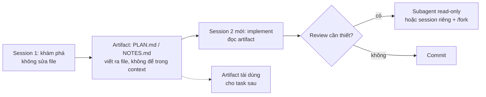

# Đề xuất của cộng đồng khi dùng `pi` coding agent

**Ngày khảo sát:** 2026-10-07 · **Phiên bản tham chiếu:** pi 1.0 (phát hành 2026-10-01), repo [`earendil-works/pi`](https://github.com/earendil-works/pi) (trước đây là `badlogic/pi-mono`, gói npm `@earendil-works/pi-coding-agent`).

**Câu hỏi nghiên cứu:** cộng đồng người dùng `pi` khuyến nghị gì về cách dùng nó — cấu hình, workflow, extension, model, chi phí, an toàn — và những khuyến nghị nào mâu thuẫn nhau.

## Mục lục

1. [Tóm tắt](#1-tóm-tắt)
2. [Phạm vi và cách đánh giá bằng chứng](#2-phạm-vi-và-cách-đánh-giá-bằng-chứng)
3. [Nguyên tắc nền tảng được nhắc nhiều nhất](#3-nguyên-tắc-nền-tảng-được-nhắc-nhiều-nhất)
4. [Workflow được khuyến nghị](#4-workflow-được-khuyến-nghị)
5. [Extension: nhóm nào được dùng nhiều, số liệu npm](#5-extension-nhóm-nào-được-dùng-nhiều-số-liệu-npm)
6. [Model, provider, chi phí](#6-model-provider-chi-phí)
7. [Bảo mật và sandbox](#7-bảo-mật-và-sandbox)
8. [Điểm đang tranh luận](#8-điểm-đang-tranh-luận)
9. [Cạm bẫy và lỗi đã được báo cáo](#9-cạm-bẫy-và-lỗi-đã-được-báo-cáo)
10. [Cộng đồng ở đâu](#10-cộng-đồng-ở-đâu)
11. [Bằng chứng yếu, cần kiểm chứng lại](#11-bằng-chứng-yếu-cần-kiểm-chứng-lại)
12. [Đối chiếu với setup trong repo này và bước tiếp theo](#12-đối-chiếu-với-setup-trong-repo-này-và-bước-tiếp-theo)
13. [Nguồn](#13-nguồn)

---

## 1. Tóm tắt

Mười khuyến nghị xuất hiện lặp lại nhiều nhất, kèm mức độ bằng chứng (`[M]` mạnh = tài liệu chính thức/tác giả/nhiều nguồn độc lập; `[1]` một nguồn; `[S]` suy luận của tôi):

1. **Bắt đầu với 0 extension** — chạy pi trần với một provider để hiểu vòng lặp 4 tool mặc định (`read`, `write`, `edit`, `bash`) trước khi cài package. `[M]` ([HandBook](https://pi-handbook.whatsinfor.me/01-philosophy/), [HN 47143754](https://news.ycombinator.com/item?id=47143754))
2. **`AGENTS.md` nên chứa lệnh kiểm chứng cụ thể, không phải lời khuyên style.** Tác giả nói model "quên" các quy tắc văn xuôi kiểu "giữ hàm dưới 30 dòng", nhưng gần như không bao giờ bỏ qua lệnh kiểm tra (`npm run check` sau mỗi thay đổi). `[M]`
3. **Kế hoạch bằng file, không phải plan mode.** Viết `PLAN.md`/`TODO.md` rồi lặp cùng agent; pi sẽ không bao giờ có plan mode hay to-do built-in, vì state bên ngoài session thì bền và chia sẻ được. `[M]` ([bài của tác giả](https://mariozechner.at/posts/2025-11-30-pi-coding-agent/))
4. **Gom context trong session riêng, rồi implement trong session mới.** Đây là "caveman workflow": explore → tạo artifact markdown → session sạch đọc artifact đó. `[M]`
5. **Dùng session tree**: `/tree`, `/fork`, `/clone` trước khi refactor rủi ro; `pi -c` / `pi -r` để quay lại. `[M]` ([docs](https://pi.dev/docs/latest/sessions))
6. **Subagent chỉ cho việc bounded/read-only** (review, tìm kiếm, việc tách rời). Chạy nhiều subagent implement song song bị chính tác giả gọi là anti-pattern. `[M]`
7. **Thay background bash bằng tmux** — pi cố tình không có background execution; tmux cho quan sát và co-debug. `[M]`
8. **Đo context và chi phí liên tục**: footer, `/session`, các package kiểu `pi-usage`/`pi-powerline-footer`; compact chủ động vì compaction phá prompt cache. `[M]` ([Compaction](https://earendil.com/posts/compaction-in-pi/))
9. **pi chạy YOLO mặc định** — không hỏi trước khi sửa file/chạy lệnh. Cách cộng đồng xử lý: container/microVM, user Linux riêng, hoặc lớp permission/sandbox (`pi-sandbox`, `pi-permission-system`). `[M]` ([Security](https://pi.dev/docs/latest/security))
10. **Đọc source package trước khi `pi install`** — extension chạy in-process với quyền user, không có sandbox. `[M]`

---

## 2. Phạm vi và cách đánh giá bằng chứng

Phạm vi: khuyến nghị *sử dụng* (setup, workflow, extension, model, chi phí, an toàn), không phải kiến trúc nội bộ. Cửa sổ thời gian: 12 tháng gần nhất, ưu tiên 3 tháng gần nhất tính từ 2026-10-07.

Tiêu chí bằng chứng:

| Mức | Nghĩa |
| --- | --- |
| `[M]` | Tài liệu chính thức pi.dev / tác giả pi / ≥2 nguồn độc lập |
| `[1]` | Một nguồn duy nhất, tự kiểm chứng được bằng URL |
| `[S]` | Tôi suy luận, không có nguồn nói thẳng |

Hai cạm bẫy của chủ đề này mà người đọc cần biết trước:

- Tên "pi" không google được (đây là lựa chọn có chủ đích của tác giả). Kết quả tìm kiếm thường rơi vào Raspberry Pi hoặc số π. Khi tìm phải dùng `pi-coding-agent`, `shittycodingagent`, hoặc `badlogic/pi-mono`. `[M]` ([HandBook: Limitations](https://pi-handbook.whatsinfor.me/09-limitations/))
- Nhiều bài "hướng dẫn pi" là nội dung SEO/marketing viết bằng AI, có nội dung trùng lặp và link affiliate. Trong khảo sát này tôi dùng chúng ở mức "một nguồn" và đã loại một bài hoàn toàn ([promptgenius.net](https://www.promptgenius.net/tools/pi) bị đánh dấu là catalog filler).

---

## 3. Nguyên tắc nền tảng được nhắc nhiều nhất

Các khuyến nghị cộng đồng hầu như đều suy ra từ 4 quyết định thiết kế của pi, nên nắm 4 điểm này trước:

| Quyết định | Hệ quả khi sử dụng | Nguồn |
| --- | --- | --- |
| System prompt + tool definitions dưới ~1.000 token; 4 tool mặc định | Model rẻ hơn, ít "bị phân tâm"; chạy tốt cả với model nhỏ/self-host | [Mario Zechner](https://mariozechner.at/posts/2025-11-30-pi-coding-agent/), [HN](https://news.ycombinator.com/item?id=47143754) |
| Mọi thứ "không cần" đều không build: plan mode, to-do, subagent, permission popup, background bash, MCP | Bạn tự dựng bằng extension/skill/file markdown; cái không có thì không thể hỏng | [HandBook: Philosophy](https://pi-handbook.whatsinfor.me/01-philosophy/) |
| YOLO mặc định — không có permission system | An toàn phải đến từ OS (container/VM/user riêng), không từ prompt | [Security](https://pi.dev/docs/latest/security) |
| Agent tự đọc docs của chính nó và tự viết extension (`/reload` hot-reload) | Cách mở rộng được khuyến nghị là "nhờ pi viết extension", không phải đi tìm package | [Armin Ronacher trích trong HandBook](https://pi-handbook.whatsinfor.me/01-philosophy/), [Extensions](https://pi.dev/docs/latest/extensions) |

Điểm 4 là điểm văn hóa mạnh nhất. Armin Ronacher mô tả: "bạn không tải một extension hay skill về; bạn bảo agent tự mở rộng chính nó". Nhiều người trong thread HN xác nhận họ dựng tool riêng thay vì cài package: override `read`/`write` sang buffer Emacs, `emacs_eval`, issue tracker riêng, footer riêng ([HN](https://news.ycombinator.com/item?id=47143754)).

---

## 4. Workflow được khuyến nghị

### 4.1 Luồng context (khuyến nghị được nhắc nhiều nhất)

Cơ sở: tác giả pi viết rõ "dùng subagent giữa session để gom context là dấu hiệu bạn chưa lên kế hoạch", và workflow đúng là gom context trong session riêng rồi tạo artifact ([bài tác giả](https://mariozechner.at/posts/2025-11-30-pi-coding-agent/)). Cộng đồng lặp lại điều này dưới dạng `/handoff` (extension `shitty-extensions`) hoặc `plannotator` để duyệt plan trước khi cho agent sửa file ([HandBook: Community](https://pi-handbook.whatsinfor.me/07-community/)).

### 4.2 Bảng lệnh/thói quen được dùng hằng ngày

| Việc | Cách làm được khuyến nghị | Nguồn |
| --- | --- | --- |
| Can thiệp khi agent đang chạy | `Enter` = steering message (dừng sau tool hiện tại), `Alt+Enter` = follow-up (chờ hết task), `Escape` = abort | [Usage](https://pi.dev/docs/latest/usage), [HandBook: Quickstart](https://pi-handbook.whatsinfor.me/10-quickstart/) |
| Chạy lệnh shell và đưa output vào context | `!git status` (có gửi cho model), `!!cmd` (không gửi) | [Usage](https://pi.dev/docs/latest/usage) |
| Khoanh vùng file thay vì để agent tự tìm | `@file` trong prompt, hoặc `pi @a.ts @b.ts "..."` | [Usage](https://pi.dev/docs/latest/usage), [PromptGenius](https://www.promptgenius.net/tools/pi) `[1]` |
| Review-only, không cho sửa | `pi --tools read,grep,find,ls` | [bài tác giả](https://mariozechner.at/posts/2025-11-30-pi-coding-agent/) |
| Dev server / REPL / debugger | Chạy trong tmux, không dùng background bash | [bài tác giả](https://mariozechner.at/posts/2025-11-30-pi-coding-agent/) |
| Headless/CI | `pi --print`, JSON mode (JSONL event), hoặc RPC mode (JSONL qua stdio) | [docs](https://pi.dev/docs/latest), [HN](https://news.ycombinator.com/item?id=47143754) |
| Kế hoạch bền giữa các session | `PLAN.md`/`TODO.md` trong repo, versioned cùng code | [bài tác giả](https://mariozechner.at/posts/2025-11-30-pi-coding-agent/) |
| Quan sát token/chi phí | Footer, `/session`, `/compact <chỉ dẫn>` (compact có định hướng chủ đề) | [Sessions](https://pi.dev/docs/latest/sessions), [HandBook: Sessions](https://pi-handbook.whatsinfor.me/04-sessions/) |

### 4.3 `AGENTS.md` — phần cộng đồng nói giống nhau nhất

- Global: `~/.pi/agent/AGENTS.md`; project: `AGENTS.md` ở repo root (pi load theo cây thư mục, file gần nhất áp dụng cho cây con). `AGENTS.override.md` thay thế trong cùng thư mục; `SYSTEM.md`/`APPEND_SYSTEM.md` để thay/append system prompt. `[M]` ([Configuration](https://pi.dev/docs/latest/configuration))
- Nội dung nên là **hợp đồng kiểm chứng được**: lệnh build/test/lint, file bị cấm (`.env`, key), quy ước thư mục. `[M]`
- Giữ ngắn: mỗi token trong context file cạnh tranh với code thật. `[M]` ([HandBook: Philosophy](https://pi-handbook.whatsinfor.me/01-philosophy/))
- Context file **được load kể cả khi bạn từ chối project trust** — nghĩa là repo lạ vẫn có thể bơm chỉ dẫn vào model. Đối xử với chúng như input không tin cậy. `[M]` ([Security](https://pi.dev/docs/latest/security))

---

## 5. Extension: nhóm nào được dùng nhiều, số liệu npm

Số liệu lượt tải dưới đây tôi tự truy vấn npm registry ngày 2026-10-07 (cửa sổ 2026-09-05 → 2026-10-04), nên đây là dữ liệu kiểm chứng được chứ không phải lời kể.

| Package | Nhóm | Việc nó làm | Lượt tải/tháng | Ghi chú/cảnh báo |
| --- | --- | --- | --- | --- |
| `pi-mcp-adapter` | Cầu nối | Thay MCP bằng 1 proxy tool (~200 token) thay vì nhồi toàn bộ tool schema | **1.507.084** | Tự tắt MCP built-in khi cài; permission extension chỉ thấy 1 tool chung; README cảnh báo tốn tới 7× nếu không dùng scriptMode |
| `pi-web-access` | Năng lực | Web search/fetch, clone GitHub, đọc PDF, hiểu video, nhiều backend | **603.369** | Cần API key cho hầu hết provider |
| `pi-subagents` | Điều phối | Subagent thật (process pi con) + workflow script, FleetView, agent dựng sẵn (scout/reviewer/oracle) | **583.422** | Subagent có thể sửa file; có giới hạn spawn (mặc định 64); tiền sử không ổn định (xem §9) |
| `pi-goal-x` | Workflow | `/goal` + plan tuần tự + auditor hoàn thành, agent tự chạy tới khi xong | **142.478** | Vòng lặp tự động — cần rào chắn |
| `@plannotator/pi-extension` | Review | Plan mode dựa trên file + UI trình duyệt để duyệt/annotate plan, diff code/PR | **119.809** | Package 41.8 MB, mở UI local |
| `pi-lens` | Phản hồi code | LSP (46 server), linter/formatter, ast-grep, read-guard, git-guard | **106.790** | 26.2 MB, cần Node ≥22.19; git-guard giữ commit khi còn finding |
| `pi-powerline-footer` | Quan sát/UI | Status bar model/token/cost/context, prompt queue | **97.944** | Chiếm một phần UI editor của pi |
| `pi-memory` | Bộ nhớ | `MEMORY.md` + log ngày + scratchpad, tìm kiếm ngữ nghĩa tuỳ chọn | **40.379** | Tìm kiếm ngữ nghĩa cần binary `qmd` ngoài |
| `pi-rtk-optimizer` | Context | Ghi đè lệnh + nén output tool | **13.432** | Cộng đồng cảnh báo cắt output quá tay; không release ~3 tháng |
| `pi-observational-memory` | Bộ nhớ | Observation/reflection, tính trước memory để compaction nhanh | **8.954** | V3 phá format V2 — phải bắt đầu session sạch |
| `pi-sandbox` | An toàn | Bubblewrap/sandbox-exec cho bash, allow/deny read/write/edit | **6.945** | Cần `ripgrep` trong PATH; glob trên Linux bị bỏ qua cho bash; README tự nói tuỳ chọn browser mở "lỗ hổng bảo mật đáng kể" |
| `shitty-extensions` | Bundle | 14 extension: oracle, handoff, plan-mode, memory-mode, cost-tracker, clipboard | **67** | Được HandBook ca là "toàn diện nhất" nhưng chỉ 67 lượt tải npm → mâu thuẫn số liệu, xem §11 |
| `pi-subagent-lite` | Điều phối | Delegation tối giản, `tasks[]` song song | **128** | Không giới hạn concurrency; con không chia sẻ context |

Các package có tên trong thảo luận nhưng tôi **không** xác minh được là package còn sống: `pi-dynamic-footer` (nhiều khả năng đã đổi tên thành `pi-powerline-footer` `[S]`), `pi-contextimate` (101 lượt tải/tháng, repo nhỏ), `pi-agent-extensions` (không phải một package mà là nhiều collection cá nhân, chỉ cài qua git).

Chọn lọc theo kịch bản:

| Kịch bản | Bộ tối thiểu gợi ý bởi cộng đồng |
| --- | --- |
| Gõ code hằng ngày | `pi-lens` + footer/token (`pi-powerline-footer` hay tương đương) |
| Cần context ngoài (docs, thư viện) | `pi-web-access` |
| Task dài, nhiều bước | `pi-goal-x` hoặc `plannotator` + `pi-tasks` |
| Repo lạ / không tin cậy | `pi-sandbox` hoặc `pi-permission-system` (deny `.env`, key, path ngoài workspace) |
| Session lặp lại nhiều lần trong một project | **một** hệ bộ nhớ duy nhất (`pi-memory` *hoặc* `pi-observational-memory`, không cả hai) |
| Team nhiều máy | `pi pod`, `bakedpi`, hoặc container + git worktree `[1]` |

---

## 6. Model, provider, chi phí

- **Đa provider là điểm bán chính**: OAuth subscription (Claude Pro/Max, ChatGPT/Codex, Copilot, Gemini) hoặc API key; đổi model giữa session được (`Ctrl+L`, `Ctrl+P`, `/model`), và context handoff giữa provider được pi-ai xử lý (thinking trace của Anthropic được chuyển thành block `<thinking>`). `[M]` ([models](https://pi.dev/docs/latest/models), [bài tác giả](https://mariozechner.at/posts/2025-11-30-pi-coding-agent/))
- **Model rẻ + harness gọn**: vì system prompt nhỏ, pi hợp với model nhỏ/self-host. Cộng đồng HN báo cáo dùng Qwen3 Coder Next self-host, Ollama Cloud, OpenRouter (MiniMax, Kimi, Mistral), llama.cpp. `[M]` cho cơ chế, `[1]` cho từng lựa chọn model ([HN](https://news.ycombinator.com/item?id=47143754))
- **Đổi model giữa session làm mất prompt cache**: cộng đồng dùng `pi-model-switch` với alias (`cheap`, `coding`, `review`) và extension này cảnh báo khi đổi model sẽ khiến cache phải tính lại. `[1]` ([HandBook: Community](https://pi-handbook.whatsinfor.me/07-community/))
- **Chi phí là phản đối lớn nhất**: nhiều người trong HN nói API key đắt hơn subscription của Claude Code "gấp nhiều lần", nên pi chỉ đáng dùng nếu bạn có subscription dùng được hoặc model rẻ/self-host ([HN](https://news.ycombinator.com/item?id=47143754)).
- **Compaction ngốn tiền đúng một lần**: compaction chạy request tóm tắt riêng, phá prefix cache, mọi thứ sau điểm đổi phải tính lại. Khuyến nghị thực dụng: compact chủ động ở ranh giới công việc, không để auto-compact cắt giữa lúc đang gỡ lỗi. `[M]` ([Compaction](https://earendil.com/posts/compaction-in-pi/))
- **Hai tên gói, một cái bẫy**: bài hướng dẫn cũ dùng `@mariozechner/pi-coding-agent`; từ khoảng 0.80 là `@earendil-works/pi-coding-agent`. `[1]` ([AI Builder Club](https://www.aibuilderclub.com/blog/pi-agent-extensions-guide)) — và tôi xác nhận bằng chính lỗi dependency trong `pi-rtk-optimizer` (peer trỏ về tên cũ).

---

## 7. Bảo mật và sandbox

Tài liệu chính thức rất thẳng: pi không sandbox tool call; extension, language server, installer đều chạy cùng quyền của process pi; project trust chỉ quyết định resource nào được load lúc khởi động, **không** giới hạn việc tool làm được sau đó ([Security](https://pi.dev/docs/latest/security)).

Khuyến nghị của cộng đồng, xếp theo mức bảo vệ:

| Cách | Bảo vệ được gì | Nguồn |
| --- | --- | --- |
| Chạy pi trong container/VM/microVM, chỉ mount thư mục cần | Tài nguyên host không expose; là mức mạnh nhất trong thực tế | `[M]` ([docs](https://pi.dev/docs/latest/security), [HandBook](https://pi-handbook.whatsinfor.me/09-limitations/)) |
| User OS riêng (`useradd claude`) | Home dir và credential cá nhân | `[1]` ([HandBook](https://pi-handbook.whatsinfor.me/09-limitations/)) |
| Extension permission/sandbox (`pi-sandbox`, `pi-permission-system`) | Chặn lệnh phá hoại, deny `.env`/key, hỏi trước khi ghi | `[1]` + số liệu npm ở §5 |
| `--tools read,grep,find,ls` | Không ghi file, không chạy bash | `[M]` |
| Prompt "hãy cẩn thận" | Không bảo vệ gì | `[M]` — tài liệu nói thẳng trust/review không tạo ra security boundary |

Hai cảnh báo cụ thể cộng đồng hay nhắc:

- `/share` và `/export` chứa cả prompt, output tool, nội dung file, có thể cả credential — phải đọc lại trước khi chia sẻ ([Sessions](https://pi.dev/docs/latest/sessions)).
- Package bên thứ ba là "shell script chạy với quyền của bạn": review source trước khi `pi install`, và bật `--local`/`-l` cho project để biết chính xác cái gì được load.
- Ví dụ gondolin (microVM) từng mặc định **allow-all egress**: không truyền `httpHooks` nghĩa là VM ra internet tự do, và `dns: "synthetic"` một mình không chặn HTTP. Issue [#6297](https://github.com/earendil-works/pi/issues/6297) bị bot auto-close. Nếu copy ví dụ này làm sandbox, phải tự thêm allowlist.

---

## 8. Điểm đang tranh luận

| Chủ đề | Phe A | Phe B |
| --- | --- | --- |
| Subagent | Cần thiết để tách context ồn ào; dùng rộng rãi (`pi-subagents` 583K/tháng) | Tác giả pi: subagent là "hộp đen trong hộp đen", khó debug, và chạy nhiều subagent implement song song là anti-pattern; cộng đồng minimalist đề xuất nhiều session nhỏ nối bằng shell |
| Tối giản vs đóng gói sẵn | Giữ pi trần, tự dựng extension — đó là điểm hấp dẫn | Fork `oh-my-pi` được nhiều người HN nói đang dùng hằng ngày; một số gọi nó là "pi bản batteries-included", số khác nói nó "mất tinh thần pi" |
| Chi phí | API key + provider tự chọn, không lock-in | Subscription Claude/ChatGPT rẻ hơn nhiều; nhiều người thấy pi chỉ hợp lý khi dùng được subscription |
| Compaction | Bật auto-compact cho khỏi gián đoạn | Compact thủ công ở ranh giới task để không phá prompt cache và không mất chi tiết |
| Lớp bảo mật | `pi-sandbox`/permission extension đủ cho việc thường ngày | "Container không phải security boundary" — cần microVM nếu chạy code không tin cậy ([HN](https://news.ycombinator.com/item?id=49937304)) |
| Bộ nhớ dài hạn | `pi-memory`/`pi-observational-memory` giúp session lặp lại | Ý kiến trong HandBook: `AGENTS.md` + session tree đã đủ cho 90% nhu cầu "memory" |

---

## 9. Cạm bẫy và lỗi đã được báo cáo

- **`pi-subagents` từng không ổn định.** Thread r/PiCodingAgent (~8/2026) có ba người độc lập báo subagent bị treo/không chạy/chậm; một người nói bản cập nhật thay khái niệm "chain" khai báo bằng `WorkflowScript` (JavaScript) làm workflow của họ hỏng vì model điều phối rẻ không theo được; một người gỡ luôn và định tự viết. Lưu ý: các báo cáo này **trước** pi 1.0 (2026-10-01), package vẫn phát triển tích cực tính đến 2026-10-07. ([thread](https://www.reddit.com/r/PiCodingAgent/comments/1vj6wjo/which_extensions_do_you_use/))
- **Rò rỉ giữa session**: một người báo `pi-intercom` để subagent mồ côi nhắn sang session không liên quan, và đã gỡ ([cùng thread](https://www.reddit.com/r/PiCodingAgent/comments/1vj6wjo/which_extensions_do_you_use/)).
- **Extension nén output có thể ăn mất thông tin**: `pi-rtk-optimizer` bị cảnh báo cắt output lệnh quá lạc quan; nó cũng đang stale (~3 tháng không release).
- **`pi-fff` gây chia rẽ**: nhanh hơn nhưng có báo cáo làm chậm khởi động và che mất context hữu ích.
- **Trùng module khi extension bundle package của host**: docs yêu cầu khai báo `@earendil-works/pi-ai`, `pi-agent-core`, `pi-coding-agent`, `pi-tui`, `typebox` ở `peerDependencies` với `"*"`, không để trong `dependencies`; nếu không sẽ có nhiều instance registry/class và cảnh báo extension. Pi 1.0 còn đổi cách nạp tool (deferred/codemode) — đây là nguồn lỗi phổ biến ngay sau nâng cấp. `[M]` ([Packages](https://pi.dev/docs/latest/packages))
- **Windows là công dân hạng hai**: lỗi cú pháp lệnh và escape path liên tục; khuyến nghị chuyển sang Linux/macOS/WSL2.
- **`~/.pi` nằm thẳng trong `$HOME`** thay vì theo XDG — bị nêu trên HN như một khó chịu về convention.
- **Không có IDE integration chính thức**: chỉ terminal; cộng đồng làm vỏ ngoài (Emacs qua RPC, `modern` UI, `abyss` proxy cho ACP/Zed, `pi pod`).
- **Không có cross-session reference**: bạn không `@mention` được session khác; workaround là cho pi đọc file JSONL hoặc tự viết `/recall`.

---

## 10. Cộng đồng ở đâu

| Kênh | Trạng thái | Ghi chú |
| --- | --- | --- |
| [r/PiCodingAgent](https://www.reddit.com/r/PiCodingAgent/) | Sôi động, thread hữu ích nhất về extension | Nguồn tốt nhất cho "ai dùng gì, và cái gì hỏng" |
| Discord (link từ [pi.dev/packages](https://pi.dev/packages)) | Được cả tài liệu lẫn HandBook nhắc | Nơi tác giả extension trả lời |
| [Pi Coding Agent Handbook](https://pi-handbook.whatsinfor.me/) | Tài liệu cộng đồng phi chính thức, chất lượng cao | Đọc mục Philosophy, Sessions, Community, Limitations |
| [HN thread 47143754](https://news.ycombinator.com/item?id=47143754) (608 điểm, 2/2026) | Thảo luận "harness tối giản" | Nhiều tên dự án cộng đồng: `oh-my-pi`, `pz` (viết lại bằng Zig), Emacs mode, `modern`, plannotator |
| [HN: pi pod](https://news.ycombinator.com/item?id=49937304) | Show HN 121 điểm | Sandbox self-host cho team; thread toàn về sandbox/microVM |
| [pi.dev/packages](https://pi.dev/packages) | Gallery chính thức, quét keyword `pi-package` trên npm | Cách tìm package mới |
| `badlogic/pi-skills` | Skill do tác giả duy trì (2.589★), git-only | Cập nhật gần nhất ~6/2026 `[1]` |

---

## 11. Bằng chứng yếu, cần kiểm chứng lại

- **"`shitty-extensions` là package cộng đồng toàn diện nhất"** (HandBook) so với **67 lượt tải npm/tháng** (tôi tự đo). Một trong hai sai, hoặc HandBook đánh giá theo mức độ được nhắc trên Discord/GitHub chứ không theo npm. Không loại trừ khả năng có tên scope khác trên npm.
- **`pi-contextimate`**: chỉ 101 lượt tải/tháng, maintainer nhỏ; khuyến nghị "quan sát context" của cộng đồng chủ yếu dựa trên vài bình luận Reddit.
- **Nhãn "consensus" cho `pi-web-access`/`pi-permission-system`** đến từ các thread Reddit mà tôi chỉ đọc trực tiếp được một phần (Reddit render chậm, phần lớn nội dung qua cache); nên coi là "được nhắc nhiều" hơn là "thống nhất".
- **Số "1,2M lượt tải mỗi tuần"** trong HandBook không khớp với bất kỳ con số npm nào tôi đo được (chỉ riêng `pi-mcp-adapter` đã 1,5M/tháng). Cần nguồn gốc nếu định trích.
- **Benchmark**: Databricks/Shopify/Terminal-Bench được các bài SEO dẫn lại, tôi chưa kiểm chứng được báo cáo gốc. Terminal-Bench 2.0 thì có script tái lập ([badlogic/pi-terminal-bench](https://github.com/badlogic/pi-terminal-bench)).
- **Fork `oh-my-pi`, `pz`, `modern`, `abyss`, `bakedpi`**: có thật, nhưng độ bảo trì hiện tại tôi không kiểm tra.

---

## 12. Đối chiếu với setup trong repo này và bước tiếp theo

`config/settings.json` hiện khai báo 20 package. So với các khuyến nghị ở trên:

Đã khớp: `pi-web-access`, `pi-subagents`, `@juicesharp/rpiv-ask-user-question`, `pi-goal-x`, `pi-memory`, `pi-lens`, `pi-powerline-footer`, `pi-model-fallback`, `pi-advisor-flow` + extension nội bộ `compaction-policy.ts` (đúng pattern "lời khuyên từ model thứ hai" và "tự thay compaction" mà cộng đồng khuyến nghị), cùng `pi-footer` + extension nội bộ `pi-footer-cache-tps.ts` (quan sát token/TPS). (`pi-tool-display` đã gỡ khỏi snapshot — trùng chức năng với pi-claudify; `pi-mcp-adapter` cũng không còn, MCP đã built-in.)

Khoảng trống đáng cân nhắc, theo thứ tự giá trị:

1. **Không có lớp permission/sandbox nào.** Đây là khuyến nghị an toàn được nhắc nhiều nhất và setup này hiện chạy YOLO hoàn toàn. Thử `pi-sandbox` (cần `ripgrep`, Linux) hoặc `@gotgenes/pi-permission-system` (fail-closed, deny `.env`).
2. **MCP đang đi qua `pi-mcp-adapter` trong khi pi 1.0 đã có MCP + Codemode tích hợp.** Chính tài liệu so sánh của adapter nói chi phí có thể tới 7× nếu không dùng scriptMode — nên đo lại trên vài session thật trước khi quyết định giữ.
3. **`pi-subagents` đang bật nhưng bằng chứng ổn định là trước 1.0.** Giữ version pin và thử lại tình huống "subagent treo" trước khi dùng cho việc dài.
4. **Chưa có bước duyệt plan trước khi sửa file** ngoài `rpiv-ask-user-question` + `pi-goal-x`; nếu muốn theo "caveman workflow", thêm quy ước `PLAN.md` vào `AGENTS.md`/`APPEND_SYSTEM.md` (repo đã có `config/APPEND_SYSTEM.md`) — đây là thay đổi rẻ nhất và không thêm dependency.
5. **`pi-rtk-optimizer` không có trong list** — đúng tinh thần cảnh báo của cộng đồng, không cần thêm.
6. **Chỉ giữ một hệ bộ nhớ** (`pi-memory` đang có; đừng thêm `pi-observational-memory` cùng lúc).

---

## 13. Nguồn

Chính thức / tác giả:

- https://pi.dev/docs/latest (và các trang `usage`, `sessions`, `configuration`, `skills`, `extensions`, `packages`, `models`, `security`, `how-pi-works`)
- https://mariozechner.at/posts/2025-11-30-pi-coding-agent/ — "What I learned building an opinionated and minimal coding agent"
- https://earendil.com/posts/pi-1-0/ (2026-10-01), https://earendil.com/posts/compaction-in-pi/ (2026-08-13), https://earendil.com/posts/pi-durable/
- https://github.com/earendil-works/pi/issues/6297 — gondolin egress
- npm registry `api.npmjs.org/downloads/point/last-month/*`, truy vấn 2026-10-07

Cộng đồng:

- https://pi-handbook.whatsinfor.me/ (Philosophy, Sessions, Community, Limitations, Quickstart)
- https://www.reddit.com/r/PiCodingAgent/comments/1vj6wjo/which_extensions_do_you_use/
- https://news.ycombinator.com/item?id=47143754 (Pi – A minimal terminal coding harness)
- https://news.ycombinator.com/item?id=49937304 (Show HN: pi pod)
- https://www.aibuilderclub.com/blog/pi-agent-extensions-guide (kiến trúc extension in-process)
- https://www.bitdoze.com/pi-coding-agent-setup-guide/ (có link affiliate — dùng thận trọng)
