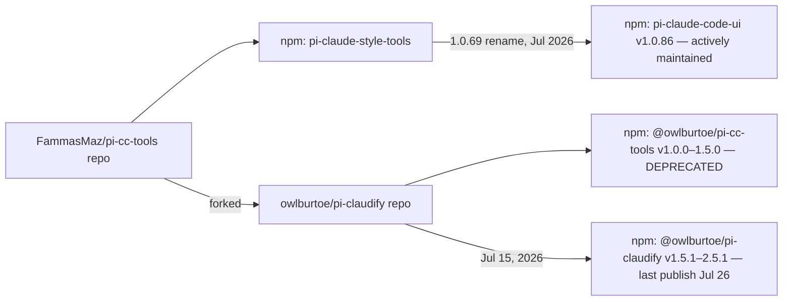

# Research Report: `@owlburtoe/pi-cc-tools` → `@owlburtoe/pi-claudify`

*Research conducted 2026-10-09.*

## Outcome first

`github.com/owlburtoe/pi-cc-tools` **does not exist** (HTTP 404 — the repo was never under that owner/name). The npm package `@owlburtoe/pi-cc-tools` exists but is **deprecated** — npm marks it: *"Renamed to @owlburtoe/pi-claudify. Install that instead."*

The package is the **pi-claudify** extension: Claude Code-style transcript rendering for [pi](https://github.com/earendil-works/pi). Canonical sources:

| What | Where |
|---|---|
| npm package | `@owlburtoe/pi-claudify` v**2.5.1** (last publish 2026-07-26) |
| Primary repo | `forgejo.owlburtoe.dev/owlburtoe/pi-claudify` (MIT) |
| GitHub mirror | `github.com/owlburtoe-labs/pi-claudify` (master == Forgejo master, both 2.5.1) |
| Upstream fork source | `github.com/FammasMaz/pi-cc-tools`, published as `pi-claude-code-ui` v**1.0.86** (still active, last publish 2026-10-08) |

## Rename history (two layers)



## What pi-claudify does

Claude Code-faithful transcript rendering for pi, built on a "capture, don't guess" methodology (author records live Claude Code sessions and asserts the captures in tests):

- `⏺ Tool(args)` call rows, `⎿` result rows, gray→green/red status bullets, OSC-8 clickable file paths.
- Read-only tools (`read`, `grep`, `find`, `ls`, `bash`) aggregate under one gerund header (`⏺ Searching for 1 pattern, reading 2 files…`) and collapse to a dim past-tense summary. MCP calls render barely at all — one clause naming the server — matching current Claude Code behavior.
- Claude-palette unified diffs with line-number gutter, no box chrome; plain (unhighlighted) removed lines.
- Sentence-form results (`Wrote 3 lines to <path>`), semantic bash labels (`nl -ba f | sed -n '1,200p'` → `Read file (lines 1-200)`).
- Grammar matched to Claude Code **v2.1.207**: `❯` user rows, `(ctrl+o to expand)` hints, `✻ Cooked for 8s` worked lines.
- Claude-style **fullscreen TUI**, footer, and a `/claudify` settings screen writing to `~/.pi/settings.json` (theme, diffs, spinner verbs, messages, tool-output sections).

Requires pi ≥ **0.84.0** (README) / peers `pi-coding-agent` and `pi-tui` **≥0.74.0**. Runtime deps: `diff`, `shiki`, `@shikijs/cli`.

## Adoption & activity

| Package | Latest | Last publish | Monthly downloads |
|---|---|---|---|
| `@owlburtoe/pi-claudify` | 2.5.1 | 2026-07-26 | 136 |
| `@owlburtoe/pi-cc-tools` (deprecated) | 1.5.0 | 2026-07-14 | 107 |
| `pi-claude-code-ui` (upstream) | 1.0.86 | 2026-10-08 | 1,387 |
| `pi-tool-display` (installed here) | — | — | 2,620 |

GitHub mirror stats: 0 stars, 0 forks; upstream `FammasMaz/pi-cc-tools`: 41★/27 forks. Upstream ships roughly weekly fix releases; claudify's npm line has been quiet since late July, though the mirror shows August work (fullscreen TUI, Claude-style task lists) that landed after 2.5.1 — no 2.6.0 release yet. [INFERENCE: development is ongoing but releases lag.]

## Risk for this setup (`pi-setup`)

- **Overlap — conflicts with `pi-tool-display`.** Both replace the same built-in tool renderers (`read`/`grep`/`find`/`ls`/`bash`/`edit`/`write`). Claudify additionally patches pi internals globally (`PATCH_FLAG`/`TOOL_CACHE_PATCH_FLAG`/`CUSTOM_MESSAGE_PATCH_FLAG` symbol guards in `extensions/index.ts`) and installs a **footer** (`installClaudeFooter`) — which would fight the `pi-footer` three-row statusline this repo relies on. Do not run both tool-display extensions; if evaluating claudify, remove `npm:pi-tool-display` and expect the footer to need checking.
- **Config write surface.** `/claudify` writes user-scoped keys into `~/.pi/settings.json` — the same manifest this repo mirrors to `config/settings.json`. The backup script will pick up any claudify keys (that's fine, they're plain settings), but they'll ship to restored machines.
- **Upstream alternative.** `pi-claude-code-ui` (the project claudify forked from) is more adopted and more actively released; it targets a similar Claude-style render but with configurable output modes rather than strict grammar fidelity.

## Install

```bash
pi install npm:@owlburtoe/pi-claudify
```

Do **not** install `npm:@owlburtoe/pi-cc-tools` — deprecated, frozen at 1.5.0 (Jul 14).

## Actionable next steps

1. To trial claudify in this setup: remove `npm:pi-tool-display` from `config/settings.json`, add `npm:@owlburtoe/pi-claudify`, then check whether its footer conflicts with the `pi-footer` three-row layout.
2. If the goal is only Claude-style tool rows (not the full transcript/TUI grammar), compare against `pi-claude-code-ui` — same lineage, 10× the downloads, actively patched for pi 0.85+.
3. Source-code work goes against the Forgejo repo or the GitHub mirror `owlburtoe-labs/pi-claudify` (they're in sync at 2.5.1).

## Sources

- npm registry: `@owlburtoe/pi-cc-tools`, `@owlburtoe/pi-claudify`, `pi-claude-code-ui` metadata (deprecation notice, versions, peer deps, publish dates)
- GitHub: `owlburtoe-labs/pi-claudify` README/master, `FammasMaz/pi-cc-tools` README + CHANGELOG, repo search API
- Forgejo: `forgejo.owlburtoe.dev/owlburtoe/pi-claudify` (tree, commits, package.json)
- pi.dev package pages: `@owlburtoe/pi-cc-tools`, `@owlburtoe/pi-claudify`
- npm downloads API (last-month counts)

## Unresolved

- Whether pi ≥0.84 (README floor) is still accurate for 2.5.1 vs. the newer fullscreen-TUI code on master.
- Whether claudify's footer can be disabled to coexist with `pi-footer` (settings screen has no obvious footer toggle; needs a hands-on install to confirm).
